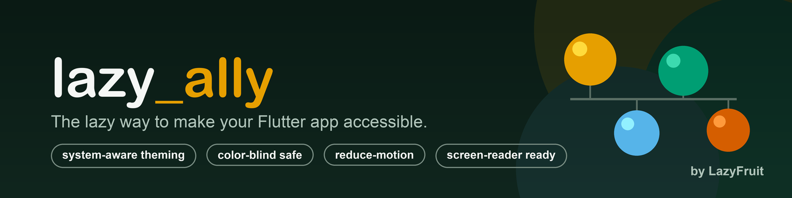
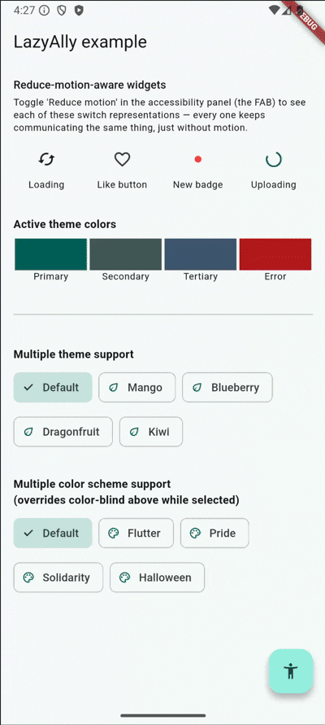

# 🍊 lazy_ally

[](https://pub.dev/packages/lazy_ally)
[](https://github.com/okunamutata/lazy_ally/actions/workflows/ci.yaml)
[](https://flutter.dev)
[](LICENSE)

lazy_ally makes your Flutter app accessible with one widget. It handles system-aware theming,
color-blind support, reduce-motion, and screen-reader announcements, built on the official Flutter
`material_ui` package.

---

## Features

- **Official library, zero filler.** lazy_ally uses only `material_ui` `ThemeData`, `ChangeNotifier`,
  and `InheritedNotifier`. It does not replace `MaterialApp`, bundle fonts, or add a state-management
  package.
- **Live system theming.** lazy_ally syncs system/light/dark mode to the OS continuously, not only at
  launch.
- **Color-blind safe by default.** lazy_ally uses the [IBM color-blind-safe
  palette](https://www.ibm.com/design/language/color/#color-blindness) out of the box. The palette is
  contrast-correct and independent of brightness, so a color-blind user keeps their light/dark
  preference.
- **Named custom themes and color schemes.** Two independent, open-ended registries let you swap the
  whole `ThemeData` or just the `ColorScheme`. Both resolve live against the active brightness.
- **Text scale that respects the OS.** lazy_ally seeds text scale from the system's own text scaler
  and composes with it. It does not silently override a user's accessibility setting.
- **Reduce-motion aware controls.** Under reduce-motion, built-in widgets swap to simple,
  non-animated alternatives, not a toned-down version of the same animation.
- **Screen-reader announcements.** Every interactive widget announces its own state changes through
  `SemanticsService`, out of the box.
- **Ready for translation.** You can override every string through one `LazyAllyLabels` object.
  lazy_ally does not need an `intl`/`Locale` dependency.
- **Pluggable persistence.** Bring your own storage through plain `loadLazyAllyPreferences`/
  `onLazyAllyPreferencesChanged` hooks. A documented pattern avoids a flash on startup.
- **Well tested.** 44 package tests and 16 example/widget tests run in CI on every push.



---

## What "lazy" means here

**lazy** *(adj.)*

> I choose a lazy person to do a hard job. Because a lazy person will find an easy way to do it.
>
> — Bill Gates…
or Steve Jobs…
definitely not Mark

A `lazy_ally` widget is lazy in the way a seatbelt is lazy. We measure that by what you do *not* have to
build: the harder the accessibility problem, the easier the implementation and developer experience need
to be.

---

## Why

- Most Flutter apps wire the same three things by hand: a light/dark theme switch, a way to keep text
  size adjustable, and some form of reduced-motion support.
- Accessibility-minded work often takes a back seat to domain-specific features and shipping deadlines.
- Apps solve the same accessibility problems again and again.
- We saw a need for a Flutter-native, low-maintenance interface that uses only `ThemeData`,
  `ChangeNotifier`, `InheritedNotifier`, and `BuildContext`. These are the same primitives you would
  reach for if you built it yourself and had the time.

---

## Install

```yaml
dependencies:
  lazy_ally: ^1.0.5
```

---

## How lazy is lazy?

Ranked by how much work each one saves you. The harder the problem, the lazier the fix.

### Dynamic brightness, text scale, and color-blind support — not lazy at all 🤧

```dart
runApp(LazyAlly(light: myLightTheme, dark: myDarkTheme, child: const MyApp()));
```

### The whole accessible settings surface — extremely lazy 🥱

```dart
void main() => runApp(
      LazyAlly(
        light: myLightTheme,
        dark: myDarkTheme,
        loadLazyAllyPreferences: _loadCache,                       // persistence, your choice of storage
        onLazyAllyPreferencesChanged: _saveCache,
        child: const MyApp(),
      ),
    );

class MyApp extends StatelessWidget {
  const MyApp({super.key});

  @override
  Widget build(BuildContext context) {
    return MaterialApp(
      theme: context.lazyAllyTheme,
      home: Scaffold(
        floatingActionButton: FloatingActionButton(
          onPressed: () => showModalBottomSheet<void>(
            context: context,
            builder: (_) => const LazyAllyPanel(),
          ),
          child: const Icon(Icons.accessibility_new),
        ),
        // ...
      ),
    );
  }
}
```

This gives you brightness, text scale, color-blind, and reduce-motion support: live, persisted,
announced, and translatable, behind one button. See the full runnable version in
[`example/`](example/).

---

## Usage

```dart
import 'dart:async';
import 'dart:developer';

import 'package:material_ui/material_ui.dart';
import 'package:lazy_ally/lazy_ally.dart';

void main() => runZonedGuarded(
  () async {
    WidgetsFlutterBinding.ensureInitialized();

    // Prefetch before runApp so loadLazyAllyPreferences below returns an
    // already-known value instead of a Future. LazyAlly then applies the
    // value in initState, before the first frame, with no flash of
    // constructor defaults. This is the recommended pattern. A
    // Future-returning loadLazyAllyPreferences still works, but it cannot
    // avoid that flash.
    final LazyAllyPreferences? cachedPrefs = await readCachedLazyAllyPreferences();

    runApp(
      LazyAlly(
        light: myLightTheme,
        dark: myDarkTheme,
        // Optional — everything below has a reasonable default.
        colorBlindScheme: (light: /* ... */, dark: /* ... */),
        customColorSchemes: <String, LazyAllyColorSchemePair>{ /* ... */ },
        initialCustomScheme: 'pride',
        customThemes: <String, LazyAllyThemePair>{ /* ... */ },
        initialCustomTheme: 'mango',
        textScaleMin: 0.85,
        textScaleMax: 1.6,
        textScaleDefault: 1.0,
        initialMode: kLazyAllySystem,
        initialColorBlind: false,
        initiallyDisableAnimation: false,
        loadLazyAllyPreferences: () => cachedPrefs,
        onLazyAllyPreferencesChanged: (LazyAllyPreferences prefs) => /* ... */,
        child: const MyApp(),
      ),
    );
  },
  // runZonedGuarded catches errors thrown asynchronously (for example,
  // during the prefetch above) that would otherwise crash silently before
  // runApp.
  (Object error, StackTrace stackTrace) => log('$error:\n$stackTrace'),
);

class MyApp extends StatelessWidget {
  const MyApp({super.key});

  @override
  Widget build(BuildContext context) {
    // Works because MyApp.build's context is already a descendant of the
    // LazyAllyProvider that LazyAlly installs above it.
    return MaterialApp(
      theme: context.lazyAllyTheme,
      home: const HomePage(),
    );
  }
}
```

Read and change settings anywhere below `LazyAlly` via `context.lazyAlly`:

```dart
final LazyAllyController ally = context.lazyAlly;
ally.setMode(kLazyAllyDark);       // kLazyAllySystem | kLazyAllyLight | kLazyAllyDark
ally.setColorBlind(true);
ally.setTextScaleFactor(1.2);      // clamped to [textScaleMin, textScaleMax]
```

`kLazyAllySystem` is the default mode. It tracks the OS's live platform brightness continuously. There
is no built-in "extra dark" mode. Register a variant like that as a named `customThemes` entry instead.
See [TROUBLESHOOTING.md](TROUBLESHOOTING.md#there-is-no-extra-dark-mode).

### Control widgets

`LazyAllyBrightnessSelector`, `LazyAllyTextScaleSlider`, `LazyAllyColorBlindSwitch`, and
`LazyAllyReduceMotionSwitch` read and write `context.lazyAlly` directly. Drop them anywhere below
`LazyAlly`. `LazyAllyPanel` is a pre-composed column of the first four, meant for a
`showModalBottomSheet`/dialog/settings-page that you build and manage yourself. LazyAlly stays out of
navigation decisions:

```dart
showModalBottomSheet<void>(
  context: context,
  showDragHandle: true,
  builder: (_) => const LazyAllyPanel(
    // Defaults to true — set to false if your app is not ready to expose
    // reduce motion yet. The rest of the panel is unaffected.
    showReduceMotion: false,
  ),
);
```

### Reduce-motion-aware content

For your own widgets that need to swap to a static-but-still-communicative alternative under
reduce-motion, use `LazyAllyReducedMotionBuilder` instead of wiring up your own
`ValueListenableBuilder<bool>`. It needs no extra state to manage and no `AnimationController` to
start or stop:

```dart
LazyAllyReducedMotionBuilder(
  motionChild: const CircularProgressIndicator(),
  reducedMotionChild: const Text('Loading…'),
)
```

If you need the current `reduceMotion` value itself, use a `ValueListenableBuilder<bool>` on
`context.lazyAlly.reduceMotionListenable` directly instead. This is most useful for starting or
stopping an `AnimationController` you own, so it does not keep ticking invisibly behind whichever
child is not shown. See `example/lib/widgets/motion_examples.dart` for worked examples of both.

### Non-English apps

Every LazyAlly widget defaults to English copy but accepts a `labels: LazyAllyLabels` override: chip
labels, switch titles/subtitles, panel headings, and the accessibility announcements each widget
sends. It is a plain data class, not a localization framework. Build one from your own
`AppLocalizations`/ARB-generated strings and pass it to `LazyAllyPanel` (which forwards it to every
control it renders) or to an atomic widget directly. See the [`LazyAllyLabels`
dartdoc](lib/src/domain/lazy_ally_labels.dart) for every field.

### Accessibility announcements

Every interactive LazyAlly widget calls `lazyAllyAnnounce` (through `SemanticsService.sendAnnouncement`)
on state change, since selecting a new chip/switch value does not itself generate a spoken
confirmation. `lazyAllyAnnounce` is exported so your own custom controls (for example, a bespoke
`itemBuilder`) can match the same standard.

---

## Common gotchas

This is the short version. See [TROUBLESHOOTING.md](TROUBLESHOOTING.md) for the full explanation and
fix for each:

- [First-frame flash on startup with an `async loadLazyAllyPreferences`](TROUBLESHOOTING.md#my-settings-flash-back-to-defaults-for-a-frame-on-startup)
- [Reduce motion does not stop *everything* from animating](TROUBLESHOOTING.md#reduce-motion-does-not-stop-everything-from-animating)
- [A `Switch`/`Slider`-based control keeps animating regardless](TROUBLESHOOTING.md#a-toggleslider-keeps-animating-even-with-reduce-motion-on)
- [Settings changed inside a bottom sheet/dialog do not repaint](TROUBLESHOOTING.md#toggling-a-setting-from-inside-a-bottom-sheetdialog-does-not-repaint)
- [Your own `MediaQuery(builder: ...)` shadows LazyAlly's](TROUBLESHOOTING.md#my-own-mediaquery-override-clobbers-lazyallys-text-scalereduce-motion)

---

## Design decisions

- **Color-blind is a flag, not a fourth theme.** Brightness (`system`/`light`/`dark`) and color-blind
  (`on`/`off`) are independent axes, so a color-blind user keeps their light/dark preference. Turning
  it on swaps in a full `ColorScheme`, not a hand-indexed color list. Named slots (`primary`,
  `secondary`, and others) are harder to misuse than `palette[i]`.
- **No built-in brightness variants.** Only `system`/`light`/`dark` are built in. A variant like "extra
  dark" is just a named `customThemes` entry, the same open mechanism any other named theme uses.
- **Theme/scheme overrides are light/dark pairs, resolved by the package. Correctness is yours.**
  LazyAlly always picks the member matching the active brightness, so a selected pair never ends up
  mismatched. It does not inspect or "fix" either member.
- **No `MaterialApp` replacement, no bundled font.** `LazyAlly` wraps your app. It does not ask you to
  swap widgets or pay for typography you did not ask for.
- **No bundled storage or localization framework.** `loadLazyAllyPreferences`/`onLazyAllyPreferencesChanged`
  and `LazyAllyLabels` are plain hooks/data classes. Bring `SharedPreferences`/`intl`/whatever you
  already use.

---

## Related

If you also want **dev-time** accessibility auditing (contrast checks, tap-target size, missing
semantics) during development, pair this with
[`accessibility_tools`](https://pub.dev/packages/accessibility_tools). It does a different job, and
the two complement each other rather than compete.

---

## Contact

- **Bugs & feature requests:** [GitHub Issues](https://github.com/okunamutata/lazy_ally/issues)
- **General inquiries:** [lazyfruit.dev](https://lazyfruit.dev)
- **Email:** [lazy.ally.reprise769@passmail.net](mailto:lazy.ally.reprise769@passmail.net)

 Maintained by **LazyFruit**, a public-interest Flutter studio.

---

## Contributing

See [CONTRIBUTING.md](CONTRIBUTING.md). This is the author's first published Dart/Flutter package.
Issues, PRs, and "this API is awkward, here is why" feedback are genuinely welcome.

---

## License

MIT — see [LICENSE](LICENSE).

---

Made with ♥️ in North Carolina.
